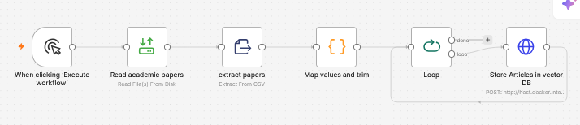
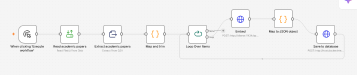
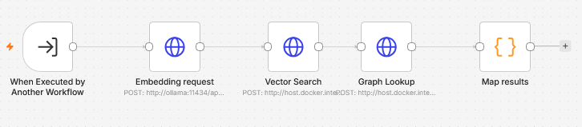
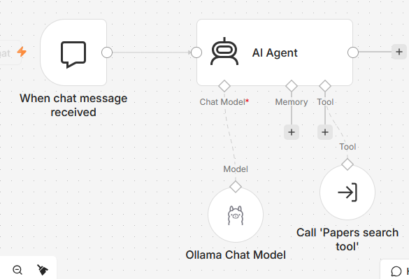

# RAG-Project

Research-paper assistant that searches papers using vector and graph retrieval.

## Workflows

- [Agent, model, instructions and tool connection](AI_agent/Chat%20model%20with%20graph_vector%20tools.json#L20-L128) — model: `qwen3:1.7b` ([config](AI_agent/Chat%20model%20with%20graph_vector%20tools.json#L35-L38)).
- [Graph population](Populate_DB_workflow/Graph_workflow.json#L17-L99) — creates `Paper` and `Category` nodes linked by `IN_CATEGORY`.
- [Embedding population](Populate_DB_workflow/Embedding_workflow.json#L30-L120) — embeds papers and saves them to Neo4j.
- [Paper search](Search_Paper_tool/Papers%20search%20tool%281%29.json#L12-L99) — vector search plus category lookup.

## Graph data populate workflow

## Embedding workflow

## Paper search tool

## Agent workflow

## Test examples

**Question: Give me a short description of AI**

Answer:

    Here are some key findings from the papers related to AI:

    Game theory of academic effort and hiring in the age of AI
    This paper explores how AI is changing the landscape of academic research. It suggests that the reliability of academic signals (like research papers) is diminishing due to the ease of producing high-quality content with AI. It raises questions about how academia should adapt to this new reality.

    Why and How to Do Science When AI Is Better at It
    This paper addresses the challenges of maintaining human involvement in science when AI can perform core scientific tasks. It emphasizes the importance of human understanding and direction in science and proposes a framework for when and how humans should use AI.

    Gym-Anything-RT: Scaling Real-Time Environments for Vision-Language Agents
    This paper discusses the performance of AI agents in real-time environments, such as video games or physical devices. It highlights the challenges of training models for real-time interaction and suggests ways to improve their performance in such settings.

    These papers cover topics related to AI's impact on academic research, human-AI collaboration, and the limitations of AI in real-time environments.  

Assesment:

    Udmærket svar men den er meget tung på at referer til artkiklerne. Jeg tror den hovedsagelige begrænsning er den lille model der bruges.

**Question: Tell me in short of any exciting developments in tech**

Answer:

    The paper collection highlights several exciting developments in technology, particularly in the fields of artificial intelligence and time series analysis. Here are the most relevant findings:

    Large Language Models (LLMs): The paper provides a plain-language overview of LLMs, emphasizing their role in generating text and the importance of understanding how training and prompts influence their performance. This is crucial for engineers using tools like ChatGPT.

    Prospector: This paper introduces a compact graph traversal policy for scientific reasoning, addressing the challenge of reasoning over large and complex knowledge graphs. Prospector enables efficient and accurate reasoning in specialized engineering fields.

    AdaTrendLike: This innovative approach tackles time series anomaly detection in large-scale, non-stationary data. It focuses on adaptive hierarchical detrending and trend likelihood scoring, improving the detection of anomalies in industrial IoT data.

    These developments showcase advancements in AI, knowledge representation, and time series analysis, with potential applications in engineering, science, and data analysis.

Assessment:

    Et svar som er i noget mere chatbot stil og som bedre egner sig som en assistent i modsætningen til en søgemaskine. Det er muligt at den bare skal promptes in i spørgende retning/nysgærrig retning for ikke bare at spytte en literaturliste ud.

**Limitation or failure:**

    Agenten har en tendens til ikke at virke hvis man giver den større prompts, ligesom at systemmessage skal holdes kort, ellers begynder den at outputte "". Jeg tror dog en større model vil være væsentligt bedre, men den virker fint til proof of concept.

## Data and setup

- **Data:** Data/academic_papers.csv 
- **Graph:** `Paper` and `Category` nodes; `IN_CATEGORY` relationship.
- **Setup:** Run the graph and embedding workflows above. Configure Neo4j credentials and create the `paper_embeddings` vector index required by [paper search](Search_Paper_tool/Papers%20search%20tool%281%29.json#L12-L12).

